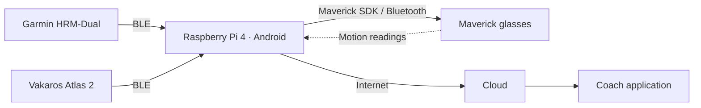

# System architecture

## Deployment



The hub is one Android application running directly on the Pi. It owns acquisition, processing, local persistence, display and upload. This is the team's selected deployment; compatibility of the Android image, Bluetooth and Maverick SDK still requires physical testing.

## Implementation directories

```text
raspberry_pi_hub/
  main/            App startup, sessions, telemetry, storage and cloud upload
  garmin_hrm/      Heart-rate connection and decoder
  vakaros_atlas/   Board connection and decoder
  maverick/        Glasses SDK, HUD and motion readings
```

All four folders belong to one Android application. Device code emits readings and connection status to the hub; it does not own persistence or cloud upload. Keep shared logic in `main/` until its size warrants a further split.

| Device | Interface | First integration result |
| --- | --- | --- |
| Garmin HRM-Dual | Android BLE | Real notification and verified flag-aware decoding |
| Vakaros Atlas 2 | BLE GATT; [bench protocol](../sensor_understanding/vakaros_atlas/README.md) | Validate screen agreement and the adapter on the Android Pi |
| Maverick | Android SDK | Sample visible on glasses from the Pi; motion timing/calibration recorded |

Sensor exploration lives separately in `sensor_understanding/<device_name>/`:
bench receivers, packet investigation and hardware observations. For a future
device, add that investigation folder and its eventual adapter directly under
`raspberry_pi_hub/<device_name>/`. Implementation unit tests belong to the
production module's configured test source sets, not the sensor investigations.
No extra package hierarchy is needed in the repository layout.

The coach client lives in `flutter_app/`, backend code in `cloud/`, and shared payload definitions in `contracts/`. Add subdivisions when implementation requires them.
